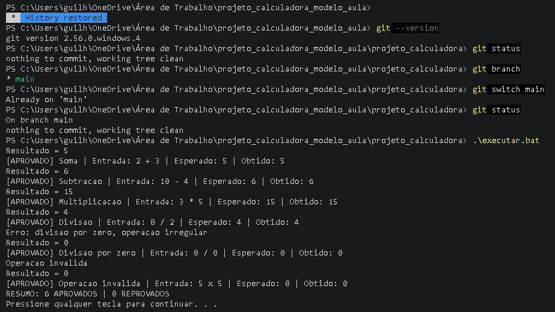
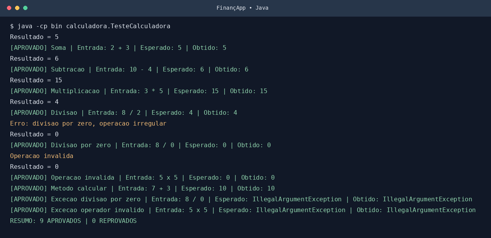
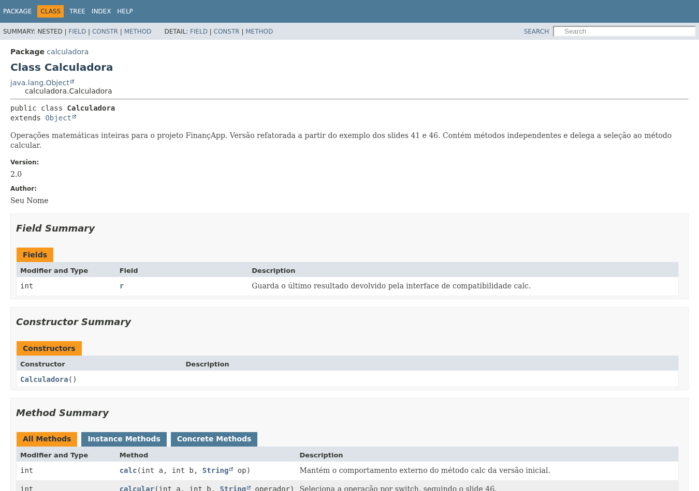

# Projeto Calculadora — FinançApp

> Projeto acadêmico desenvolvido com foco em Qualidade de Software, Testes, Refatoração, Documentação e Versionamento.

---

## 1. Identificação do Projeto

- **Projeto:** Projeto Calculadora (`projeto_calculadora`)
- **Contexto:** FinançApp
- **Aluno:** Guilherme Hatada Yonezawa
- **RA:** 250846
- **Curso:** Análise e Desenvolvimento de Sistemas
- **Disciplina:** UX/UI e Testes de Software
- **Professor:** Daniel Ohata
- **Semestre:** 2026.2
- **Branch desta versão:** `main`

---

## 2. Visão Geral

O projeto consiste no desenvolvimento de um módulo de cálculos matemáticos básicos em Java para a startup fictícia FinançApp. O módulo poderá ser usado em orçamento mensal, divisão de despesas, projeções financeiras e cálculos auxiliares. Além das quatro operações, aplica testes, tratamento de erros, refatoração, documentação JavaDoc e versionamento Git.

---

## 3. Problema

A startup necessita de um componente matemático reutilizável que, além de apresentar resultados corretos, possua **código legível**, **testes automatizados**, **tratamento de falhas**, **documentação técnica**, **controle de versões** e **facilidade de manutenção**.

---

## 4. Objetivo

### 4.1 Objetivo Geral

Desenvolver uma calculadora em Java aplicando práticas de qualidade de software, testes, documentação, refatoração e versionamento.

### 4.2 Objetivos Técnicos

- Implementar soma, subtração, multiplicação e divisão com inteiros.
- Tratar divisão por zero e operadores inválidos.
- Testar entradas, saídas e casos de erro.
- Refatorar mantendo o funcionamento da interface `calc`.
- Documentar classes, métodos, atributos e exceções com JavaDoc.
- Gerar documentação HTML na pasta `docs/`.
- Registrar alterações em commits e branches do Git.

---

## 5. Escopo Funcional

| ID | Funcionalidade | Descrição | Status |
| --- | --- | --- | --- |
| RF01 | Soma | Soma dois números inteiros | ✅ |
| RF02 | Subtração | Subtrai dois números inteiros | ✅ |
| RF03 | Multiplicação | Multiplica dois números inteiros | ✅ |
| RF04 | Divisão | Divide dois números inteiros | ✅ |
| RF05 | Validação de divisão | Bloqueia a divisão por zero | ✅ |
| RF06 | Operação inválida | Trata operadores não suportados | ✅ |

> O método trabalha com **inteiros**: por exemplo, `7 / 2` retorna `3` (divisão inteira do Java).

---

## 6. Requisitos Não Funcionais

| ID | Categoria | Requisito |
| --- | --- | --- |
| RNF01 | Qualidade | Código organizado e legível |
| RNF02 | Testabilidade | Testes executados automaticamente pela classe `TesteCalculadora` |
| RNF03 | Manutenção | Refatorar sem alterar os resultados válidos |
| RNF04 | Documentação | Documentação JavaDoc das classes e métodos |
| RNF05 | Versionamento | Git e GitHub, com branches `main` e `Refatoracao` |
| RNF06 | Confiabilidade | Erros informados sem encerrar o aplicativo inesperadamente |

---

## 7. Tecnologias Utilizadas

| Tecnologia | Versão | Utilização |
| --- | --- | --- |
| Java | 21 (compatível com Java 17+) | Código da calculadora |
| JDK | OpenJDK 21 | Compilação e execução |
| JUnit | Não utilizado | O exemplo da aula usa testes Java puro pela classe `TesteCalculadora` |
| Git | 2.47.3 no ambiente de validação | Histórico e branches |
| GitHub | — | Hospedagem remota (a publicar pelo aluno) |
| JavaDoc | Fornecido pelo JDK | Documentação HTML |
| IDE | VS Code ou Eclipse | A escolher na máquina do aluno |

---

## 8. Estrutura do Projeto

```text
projeto_calculadora/
├── src/
│   └── calculadora/
│       └── Calculadora.java
├── test/
│   └── calculadora/
│       └── TesteCalculadora.java
├── docs/
│   └── index.html
├── images/
│   ├── testes/
│   ├── javadoc/
│   └── refatoracao/
├── README.md
├── .gitignore
├── executar.bat
└── gerar_javadoc.bat
```

---

## 9. Operações e execução

| Operação | Exemplo | Resultado esperado |
| --- | --- | --- |
| `+` | `2 + 3` | `5` |
| `-` | `10 - 4` | `6` |
| `*` | `3 * 5` | `15` |
| `/` | `8 / 2` | `4` |
| `/` com zero | `8 / 0` | mensagem e retorno `0` pelo método `calc` |
| operador `x` | `5 x 5` | mensagem e retorno `0` pelo método `calc` |

Execute na raiz do projeto:

```bash
javac -encoding UTF-8 -d bin src/calculadora/Calculadora.java test/calculadora/TesteCalculadora.java
java -cp bin calculadora.TesteCalculadora
```

No Windows, também é possível usar o arquivo `executar.bat`.

---

## 10. Testes unitários e evidências

**Tabela de entradas, resultados esperados e resultados obtidos:**

| Caso | Entrada | Esperado | Obtido | Situação |
| --- | --- | --- | --- | --- |
| Soma | `2 + 3` | 5 | 5 | Aprovado |
| Subtração | `10 - 4` | 6 | 6 | Aprovado |
| Multiplicação | `3 * 5` | 15 | 15 | Aprovado |
| Divisão | `8 / 2` | 4 | 4 | Aprovado |
| Divisão por zero (`calc`) | `8 / 0` | 0 e mensagem de erro | 0 e mensagem de erro | Aprovado |
| Operador inválido (`calc`) | `5 x 5` | 0 e mensagem de erro | 0 e mensagem de erro | Aprovado |



**Após a refatoração (evidência da branch `Refatoracao`):**





*As imagens de testes apresentam a saída real da execução do Java, formatada para leitura. A imagem de JavaDoc é uma captura da página HTML gerada.*

---

## 11. Refatoração

A versão inicial contém a estrutura `if/else` do slide 41 e seis testes do slide 42.
Para consultar o código reorganizado, abra a branch [`Refatoracao`](../../tree/Refatoracao).


**Branches do repositório:** `main` (implementação inicial) e `Refatoracao` (código refatorado com testes). Os resultados da execução são conferidos antes e após a reorganização.

---

## 12. Documentação JavaDoc

Documentação gerada em [`docs/index.html`](docs/index.html). Para gerar novamente:

```bash
javadoc -private -author -version -encoding UTF-8 -charset UTF-8 -docencoding UTF-8 -d docs src/calculadora/Calculadora.java test/calculadora/TesteCalculadora.java
```

O comando também pode ser executado usando `gerar_javadoc.bat` no Windows.

---

## 13. Repositório GitHub

**URL do seu repositório:** `https://github.com/guihatada/projeto_calculadora`

O link https://github.com/dr-ohata/calculadora_refatoracao foi usado **apenas como modelo do README fornecido pelo professor**; não é o repositório de entrega do aluno.

---

## 14. Referência aos slides da aula

- Slide 41: versão inicial de `Calculadora`.
- Slide 42: seis cenários originais de teste.
- Slide 44: testes após refatoração e uso de `try/catch`.
- Slide 46: métodos extraídos, `switch` e JavaDoc.

**Antes de entregar:** preencher aluno, RA, professor e o link do próprio GitHub; publicar ambas as branches e conferir se as imagens aparecem no README online.
